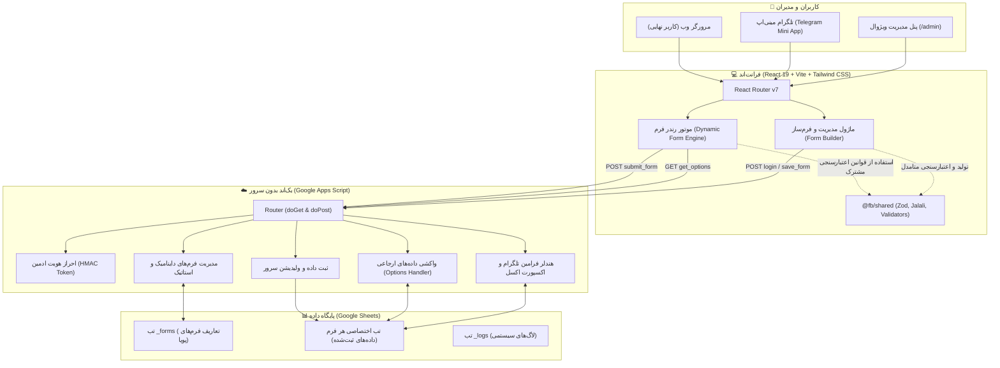

# سامانه فرم‌ساز داینامیک و بدون سرور سازمانی
## Dynamic Form Builder Ecosystem (100% Free & Serverless)

<div align="center">


**یک اکوسیستم مدرن، صفر ریال (۱۰۰٪ رایگان)، بدون سرور و دو زبانه برای ایجاد، مدیریت و انتشار فرم‌های سازمانی متصل به Google Sheets و ربات تلگرام**

[مشاهده دمو و لاگین ادمین](#-ورود-به-پنل-مدیریت-و-تست-لوکال) • [معماری سیستم](#-معماری-سیستم-architecture) • [راهنمای راه‌اندازی](#-راهنمای-نصب-و-اجرای-لوکال-quick-start) • [قابلیت‌ها](#-ویژگی‌های-کلیدی-key-features)

</div>

---

## 📖 معرفی پروژه (Overview)

پروژه **Dynamic Form Builder** یک پلتفرم فرم‌ساز جامع و بدون سرور (Serverless) سازمانی است که برای برطرف کردن نیازهای جمع‌آوری داده در سازمان‌ها و تیم‌ها با هزینه زیرساختی **صفر ریال** طراحی شده است. 

در این سیستم:
- **دیتابیس:** بر بستر **Google Sheets** قرار دارد (هر فرم یک تب مستقل و تب `_forms` برای نگهداری فرم‌های پویای مدیران).
- **بک‌اند:** بدون نیاز به سرور اختصاصی یا داکر، روی **Google Apps Script (GAS)** اجرا می‌شود و وب‌هوک‌های فرم و تلگرام را مدیریت می‌کند.
- **فرانت‌اند:** با **React 19**، **Tailwind CSS v4** و معماری مدرن **RTL-First** طراحی شده و هم به صورت وب‌اپلیکیشن مستقل و هم در قالب **Telegram Mini App** کار می‌کند.
- **پنل مدیریت ویژوال:** مدیران سیستم می‌توانند بدون کدنویسی، فرم‌های جدید بسازند، فیلدها و ولیدیشن‌ها را تنظیم کنند و فرم‌ها را با پیش‌نمایش زنده منتشر نمایند.
- **فیلد ارجاعی پویا (Cross-Form Reference):** امکان اتصال فرم‌ها به یکدیگر؛ برای مثال در فرم درخواست مرخصی، لیست کارکنان به شکل زنده از نام‌های ثبت‌شده در فرم ثبت اطلاعات کارمندان خوانده می‌شود!

---

## 🌟 ویژگی‌های کلیدی (Key Features)

### ۱. فرم‌ساز بصری تحت وب (Visual Form Builder)
- پنل مدیریت محافظت‌شده با احراز هویت ادمین (`admin` / `admin`).
- افزودن، حذف، ویرایش و مرتب‌سازی فیلدهای مختلف (متن، عدد، کد ملی، شماره موبایل، تاریخ شمسی، فیلد انتخابی، فیلد ارجاعی بین فرمی، متن چندخطی و ...).
- تعریف ولیدیشن‌های پیشرفته: حداقل و حداکثر طول/مقدار، اجباری بودن و **اعتبارسنجی عبارات باقاعده سفارشی (Custom Regex Pattern)** همراه با پیام خطای دلخواه.
- پیش‌نمایش تعاملی و زنده فرم (`Live Preview`) همگام با تغییر تنظیمات فیلدها.

### ۲. فیلد ارجاعی بین فرم‌ها (Dynamic Cross-Form Reference Field)
- امکان خواندن گزینه‌های فیلد از اطلاعات ثبت‌شده در فرم‌های دیگر.
- پشتیبانی از انتخاب تکی (Single Select) یا چندتایی (Multiple Select).
- جستجوی سریع بین آیتم‌ها با منوی دراپ‌داون مدرن و واکنش‌گرا.
- اعتبارسنجی دوطرفه در فرانت‌اند و بک‌اند بر اساس داده‌های زنده موجود در Google Sheets.

### ۳. تجربه کاربری تماماً فارسی و راست‌چین (RTL-First UX)
- استفاده از فونت متغیر استاندارد **Vazirmatn** (به صورت لوکال بدون وابستگی به CDNهای خارجی).
- پیاده‌سازی ۱۰۰٪ کلاس‌های منطقی Tailwind (`ms-*`، `pe-*`، `start-*`، `end-*`).
- جداسازی فیلدهای انگلیسی و عددی نظیر شماره موبایل، ایمیل و کد ملی در جزایر LTR (`dir="ltr"`).
- تقویم شمسی جلالی بومی و اعتبارسنجی کد ملی با الگوریتم کنترلی ده رقمی.
- تبدیل خودکار ارقام فارسی (`۰-۹`) و عربی (`٠-٩`) به اعداد لاتین قبل از ارسال و اعتبارسنجی.

### ۴. یکپارچگی عمیق با تلگرام (Telegram Bot & Mini App)
- اجرای کامل فرم‌ها به عنوان **Telegram Mini App** با پشتیبانی از دکمه اصلی (MainButton) و فیدبک لمسی (Haptic Feedback).
- هماهنگی خودکار پالت رنگی فرم با تم تلگرام کاربر (Light & Dark mode).
- ربات تلگرام مجهز به فرامین سازمانی:
  - `/forms`: لیست فرم‌های در دسترس همراه با دکمه‌های شیشه‌ای شیک.
  - `/export <formId>`: تولید مستقیم فایل اکسل بومی (`.xlsx`) و ارسال در چت تلگرام.
  - `/stats <formId>`: نمایش آمار کل و تفکیک ثبت‌های امروز.
  - اعلان آنی در کانال یا گروه مدیران پس از ثبت هر فرم.

### ۵. معماری امن و رایگان بر بستر گوگل (Google Apps Script Engine)
- مدیریت هوشمند درخواست‌های وب‌اپ بدون خطای CORS Preflight با ارسال `Content-Type: text/plain;charset=utf-8`.
- مکانیزم جلوگیری از تکرار درخواست‌های تلگرام با پاسخ استاندارد HTTP 200.
- نشست‌های امن ادمین بر پایه توکن‌های هش‌شده HMAC-SHA256.

---

## 🏗️ معماری سیستم (Architecture)



---

## 📁 ساختار فولدربندی مونو‌ریپو (Repository Structure)

```text
Form-Builder/
├── AGENTS.md                          # قوانین و استانداردهای سخت‌گیرانه توسعه و تایپ‌اسکریپت
├── package.json                       # اسکریپت‌های مونو‌ریپو (npm workspaces)
├── README.md                          # مستندات کامل پروژه
├── .env.example                       # نمونه متغیرهای محیطی مورد نیاز
│
├── shared/                            # پکیج کدهای مشترک فرانت‌اند و بک‌اند (@fb/shared)
│   ├── forms/                         # تعاریف پیش‌فرض و استاتیک فرم‌ها (JSON)
│   │   ├── employee-contact-info.json # فرم نمونه اطلاعات تماس پرسنل
│   │   └── leave-request.json         # فرم نمونه درخواست مرخصی با فیلد ارجاعی
│   └── src/
│       ├── definition.schema.ts       # متامدل فرم‌ها، فیلدها و اعتبارسنجی‌ها با Zod
│       ├── build-zod.ts               # سازنده داینامیک اسکیمای Zod بر اساس کانفیگ فیلدها
│       ├── api-contract.ts            # قرارداد تایپ‌شده تبادل داده بین فرانت و بک‌اند
│       ├── messages.fa.ts             # پیام‌های خطای استاندارد و روان فارسی
│       ├── validators/                # اعتبارسنج کد ملی، تلفن همراه، ارقام فارسی
│       └── jalali.ts                  # محاسبات و تبدیل‌های تقویم خورشیدی جلالی
│
├── frontend/                          # اپلیکیشن وب و تلگرام مینی‌اپ (@fb/frontend)
│   ├── src/
│   │   ├── app/
│   │   │   ├── App.tsx                # کانتینر اصلی اپلیکیشن
│   │   │   └── router.tsx             # مسیرهای کلاینت (/، /f/:formId، /admin/...)
│   │   ├── components/
│   │   │   ├── form-engine/           # موتور رندر فرم و پیش‌نمایش
│   │   │   │   ├── DynamicForm.tsx    # کامپوننت فرم داینامیک با React Hook Form
│   │   │   │   ├── FieldRenderer.tsx  # رندرر هوشمند انواع فیلد
│   │   │   │   └── fields/            # کامپوننت فیلدهای اختصاصی (تاریخ، ارجاعی و...)
│   │   │   ├── auth/
│   │   │   │   └── RequireAdmin.tsx   # گارد محافظ مسیرهای ادمین
│   │   │   └── ui/                    # کامپوننت‌های پایه رابط کاربری (shadcn/ui)
│   │   ├── pages/
│   │   │   ├── HomePage.tsx           # صفحه اصلی و کاتالوگ فرم‌ها
│   │   │   ├── FormPage.tsx           # صفحه پر کردن و ثبت فرم
│   │   │   └── admin/
│   │   │       ├── AdminLoginPage.tsx # صفحه ورود ادمین
│   │   │       ├── AdminFormsPage.tsx # داشبورد مدیریت فرم‌ها
│   │   │       └── FormBuilderPage.tsx# فرم‌ساز ویژوال با پیش‌نمایش زنده
│   │   └── lib/
│   │       ├── api/gas-client.ts      # ارتباط امن و ضد CORS با بک‌اند
│   │       └── telegram/              # آداپتور Telegram WebApp
│   └── vite.config.ts
│
├── gas-backend/                       # بک‌اند Google Apps Script (@fb/gas-backend)
│   ├── src/
│   │   ├── router.ts                  # توزیع‌کننده درخواست‌های doGet و doPost
│   │   ├── config.ts                  # متغیرهای سیستمی و اعتبارسنجی محیط
│   │   ├── auth/session.ts            # لاگین ادمین، هش رمز و توکن‌های HMAC
│   │   ├── forms/
│   │   │   ├── dynamic-forms.ts       # مدیریت فرم‌های دیتابیس در تب _forms
│   │   │   ├── form-resolver.ts       # ترکیب فرم‌های استاتیک و داینامیک
│   │   │   ├── options.handler.ts     # خواندن داده‌های ارجاعی بین فرم‌ها
│   │   │   └── submit.handler.ts      # پردازش و ذخیره فرم در Google Sheets
│   │   ├── sheets/                    # ماژول دسترسی به اسپريدشیت، تب‌ها و فرمول‌ها
│   │   └── telegram/                  # مدیریت فرامین تلگرام و اکسپورت XLSX
│   ├── build.mjs                      # باندلر esbuild برای پکیج کردن بک‌اند در یک فایل
│   └── appsscript.json                # مانیفست استاندارد گوگل اپز اسکریپت
│
└── scripts/                           # اسکریپت‌های اتوماسیون و ابزارهای CI/CD
    ├── gas-deploy.mjs                 # اسکریپت دیپلوی امن و بدون تغییر URL وب‌اپ
    ├── telegram-setup.mjs             # ثبت وب‌هوک و دستورات ربات در تلگرام
    └── sync-properties.mjs            # سینک خودکار متغیرهای محیطی به Script Properties
```

---

## 🚀 راهنمای نصب و اجرای لوکال (Quick Start)

### پیش‌نیازها
- **Node.js** نسخه 20 به بالا
- **npm** نسخه 10 به بالا
- یک حساب گوگل (برای اتصال به Google Sheets و Apps Script)
- توکن ربات تلگرام از [BotFather](https://t.me/BotFather) (در صورت نیاز به ربات)

### ۱. کلون پروژه و نصب پکیج‌ها
```bash
git clone https://github.com/alireza-abdii/dynamic-form-builder.git
cd dynamic-form-builder
npm install
```

### ۲. تنظیم فایل متغیرهای محیطی
یک کپی از فایل `.env.example` با نام `.env` بسازید:
```bash
cp .env.example .env
```
مقادیر مربوطه را در `.env` وارد کنید:
```env
# URL وب‌اپ Google Apps Script (از دیپلوی وب‌اپ دریافت می‌شود)
VITE_GAS_URL="https://script.google.com/macros/s/.../exec"

# آیدی گوگل شیت اصلی
SPREADSHEET_ID="your-google-sheet-id"

# توکن ربات تلگرام
TELEGRAM_BOT_TOKEN="123456789:ABCdefGHIjklMNOpqrsTUVwxyz"
WEBHOOK_SECRET="super-secret-random-token"

# ادمین‌های مجاز تلگرام (شناسه عددی اکانت تلگرام)
ADMIN_USER_IDS="12345678,87654321"

# اطلاعات ورود پیش‌فرض به پنل ادمین
ADMIN_USERNAME="admin"
ADMIN_PASSWORD="admin"
SESSION_SECRET="change-this-to-a-secure-random-key"
```

### ۳. اجرای محیط توسعه لوکال (Development Server)
```bash
npm run dev
```
اپلیکیشن در آدرس `http://localhost:5173` در دسترس خواهد بود.

---

## 🔐 ورود به پنل مدیریت و تست لوکال

1. مرورگر خود را باز کرده و به آدرس `http://localhost:5173/admin/login` بروید.
2. با اطلاعات پیش‌فرض وارد شوید:
   - **نام کاربری:** `admin`
   - **رمز عبور:** `admin`
3. پس از ورود به داشبورد (`/admin/forms`):
   - دکمه **«ایجاد فرم جدید»** را بزنید تا وارد فرم‌ساز ویژوال شوید.
   - شناسه و عنوان فرم را مشخص کرده و فیلدهای دلخواه را اضافه کنید.
   - برای تست فیلد ارجاعی، نوع فیلد را روی **«ارجاع به داده‌های فرم دیگر»** بگذارید و فرم مبدا و کلید فیلد مبدا را انتخاب کنید.
   - پیش‌نمایش زنده در ستون کناری فرم را به‌صورت لحظه‌ای بررسی کنید.
   - دکمه **«ذخیره و انتشار فرم»** را بزنید تا فرم مستقیماً در دیتابیس ابری ثبت شود.

---

## ☁️ استقرار بک‌اند (Google Apps Script Deployment)

این پروژه مجهز به اسکریپت دیپلوی ایمن است که بدون تغییر دادن آدرس وب‌اپ (`Web App URL`) کدها را به‌روزرسانی می‌کند:

```bash
# اعتبارسنجی فایل‌های فرم
npm run forms:validate

# دیپلوی امن روی استقرار موجود در گوگل
npm run gas:deploy

# سینک متغیرهای محیطی به Script Properties گوگل
npm run gas:sync-props

# ثبت وب‌هوک و دستورات ربات تلگرام
npm run tg:setup
```

---

## 🧪 تضمین کیفیت و استانداردهای مهندسی (Definition of Done)

پروژه به قوانین سخت‌گیرانه تایپ‌اسکریپت و بدون خطا پایبند است. قبل از هر انتشار این مراحل اجرا و اعتبارسنجی می‌شوند:

```bash
# اعتبارسنجی فرمت فایل‌های JSON
npm run forms:validate

# بررسی سلامت انواع داده در تمامی پروژه‌ها (Strict TypeScript - No Any)
npm run typecheck

# تست‌های جامع خودکار (Vitest)
npm test

# بررسی استاندارد کدهای فرانت‌اند و کلاس‌های منطقی Tailwind
npm run lint

# ساخت باندل نهایی فرانت‌اند و بک‌اند
npm run build
```

---

## 🤝 مشارکت و توسعه (Contributing)

توسعه‌دهندگان عزیز می‌توانند برای اضافه کردن انواع فیلد جدید، بهینه‌سازی‌های موتور رندر یا قابلیت‌های گزارش‌گیری پول‌ریکوئست (PR) ارسال نمایند. لطفاً پیش از ارسال تغییرات اطمینان حاصل کنید که کلیه تست‌ها و بررسی‌های تایپ با موفقیت پاس می‌شوند.

---

## 📄 مجوز (License)

این پروژه تحت مجوز متن‌باز **MIT** منتشر شده است. استفاده و توسعه آن برای تمامی افراد و سازمان‌ها کاملاً آزاد و رایگان است.
